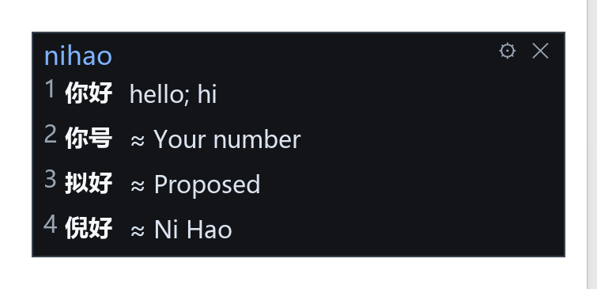
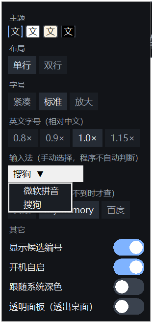

# 候选英文学习窗 · WLXDWSSLearnPanel

**打字时，在输入法候选词旁边直接显示英文释义。**

中文名：**候选英文学习窗** ｜ 当前版本：**v5** ｜ 平台：Windows 10 / 11 64 位
仓库地址：https://github.com/WLXDWSS/WLXDWSSLearnPanel

支持 **搜狗输入法** 与 **微软拼音**（设置里手动选择），词典完全离线（CC-CEDICT，约 12.5 万条），不联网也查得到。
v5 起 **WPS Office 里也能正常显示**（搜狗双进程注入）。



---

## 下载

| 版本 | 文件 | 大小 | 说明 |
|---|---|---|---|
| **便携版**（普通用户选这个） | [`download/WLXDWSSLearnPanel_v5_Windows_x64.zip`](download/WLXDWSSLearnPanel_v5_Windows_x64.zip) | 约 32 MB | 解压即用，**不需要安装 Python**，双击 `WLXDWSSLearnPanel.exe` |
| **源码版** | [`download/WLXDWSSLearnPanel_v5_source.zip`](download/WLXDWSSLearnPanel_v5_source.zip) | 约 5 MB | 需要 Python 3.9+（推荐 3.11），见[从源码运行](#从源码运行) |

> 也可以直接 `git clone` 本仓库——源码就在根目录（`src/`、`dict/`、`build/`、`启动.bat`、`停止.bat`），
> `download/` 里放的是给不方便用 git 的人准备的两个压缩包。

---

## 它长什么样

主面板常驻屏幕右上角（可拖动、位置会记住）：

```
┌──────────────────────────────┐
│ nihao                     ⚙ ✕ │   ← 顶栏：你刚敲的拼音 + 设置/退出
├──────────────────────────────┤
│ 1 你好          hello; hi     │   ← 候选汉字 + 英文释义
│ 2 你号          ≈ your number │
│ 3 拟好          ≈ proposed    │
│ 4 倪好          ≈ Ni Hao      │
└──────────────────────────────┘
```

设置面板（点齿轮打开；开始打字 / 拖动面板 / 点击面板外部都会自动收起）：



---

## 功能

| 功能 | 说明 |
|---|---|
| 候选词英文释义 | 输入法候选窗旁实时显示英文，本地词典查询，零延迟 |
| 离线词典 | CC-CEDICT 约 125,000 条，随包分发，断网可用 |
| 双输入法支持 | 搜狗（注入 hookdll + UDP 读候选）/ 微软拼音（UIA 后台线程读候选窗），设置里手动切换 |
| **WPS 支持（v5）** | WPS 是框架 + 文档双进程，v5 会同时注入两个进程，WPS 里也能读到候选 |
| 在线翻译兜底 | 本地查不到时可开：MyMemory（免 key）或百度翻译（自填 appid / key） |
| 4 套主题 | 暗夜 / 浅色 / 纸黄 / 高对比，可跟随系统深浅色 |
| 排版可调 | 单行 / 双行、3 档字号、英文字号比例 0.8×–1.15×、候选编号开关 |
| 透明面板 | 可让面板背景透出桌面 |
| 面板行为 | 拖动换位置并记住、单实例运行、开机自启开关 |
| 隐私 | 词典查询不联网；百度密钥用 Windows DPAPI 加密，只有当前 Windows 用户能解密 |

---

## 系统要求

- Windows 10 / 11（**64 位**）
- 便携版：无需任何运行时
- 源码版：Python 3.9 及以上（推荐 3.11）+ `uiautomation`、`Pillow`

---

## 快速开始（便携版）

1. 下载 `WLXDWSSLearnPanel_v5_Windows_x64.zip`，解压到任意目录（路径不要含特殊字符）
2. 双击 `WLXDWSSLearnPanel.exe`，面板出现在屏幕右上角
3. 点面板右上角 **⚙**，在「输入法（手动选择，程序不自动判断）」里选你正在用的：**微软拼音** 或 **搜狗**
4. 打开任意输入框打字，候选词旁边就会显示英文

---

## 从源码运行

```bat
pip install -r requirements.txt
```

然后双击 **`启动.bat`**（无黑窗口残留；已在运行 / 找不到 Python 都会明确提示，日志在 `logs\panel.log`）。
想直接看报错就命令行跑：

```bat
python src\main.py
```

停止：双击 **`停止.bat`**（只结束本目录 `src\main.py` 的进程，不误杀其它 Python 程序）。

### 自己打包成 exe

```bat
pip install pyinstaller
pyinstaller --noconfirm --noconsole --onedir --name WLXDWSSLearnPanel src\main.py
```

打包完成后，把 `dict\`、`build\` 两个目录复制到 `dist\WLXDWSSLearnPanel\` 里（程序按「exe 所在目录」找词典和 DLL），
再双击 `dist\WLXDWSSLearnPanel\WLXDWSSLearnPanel.exe` 即可。

---

## 首次使用（必看）

程序**不会**自动判断你用的是哪个输入法——这是刻意设计（搜狗守护进程会抵抗 TSF 检测，自动判断不可靠；双路径并行还会抢线程导致卡顿）。

所以：**点 ⚙ → 选输入法 → 立刻生效并记住**。以后换了输入法，记得回来改一下（面板等待时会显示「当前：xxx」方便核对）。

---

## 输入法兼容性

| 输入法 | 读取方式 | 有效的程序 | 读不到的程序 |
|---|---|---|---|
| **微软拼音** | UIA 读候选窗（后台线程） | 几乎所有程序 | 极少 |
| **搜狗** | 注入 `hookdll` + UDP 收候选（IMM32） | 传统 Win32 程序、**WPS Office（v5 起）**、微软 Word、微信、老式输入框 | Chrome、Electron 应用、Win11 新版记事本（这些宿主里搜狗走 TSF，读不到） |

**在 Chrome / Electron / Win11 新版记事本里打字看不到英文 → 把设置里的输入法改成「微软拼音」。**

搜狗路径若在某些程序（尤其是管理员权限运行的程序）里不工作，可右键 exe →「以管理员身份运行」。

---

## 设置项一览

| 分组 | 选项 |
|---|---|
| 主题 | 暗夜 / 浅色 / 纸黄 / 高对比 |
| 布局 | 单行 / 双行 |
| 字号 | 紧凑 / 标准 / 放大 |
| 英文字号（相对中文） | 0.8× / 0.9× / 1.0× / 1.15× |
| 输入法 | 微软拼音 / 搜狗（手动选择） |
| 在线翻译（本地查不到时才查） | 关闭 / MyMemory（免 key）/ 百度（需 appid + key） |
| 其它 | 显示候选编号 / 开机自启 / 跟随系统深色 / 透明面板 |

---

## 目录结构

| 路径 | 说明 |
|---|---|
| `src\main.py` | 主程序：候选轮询、查词、面板渲染、设置面板、在线翻译 |
| `src\mspy_reader.py` | 微软拼音：后台线程 UIA 读候选窗 + 低级键盘钩子累积拼音 |
| `src\sogou_reader.py` | 搜狗：注入 hookdll + UDP（127.0.0.1:52380）收候选；v5 起按焦点窗口同时注入框架进程与文档进程 |
| `src\cedict.py` | CC-CEDICT 词典查询 |
| `src\layered_panel.py` | 分层窗口渲染（透明无毛边）+ 显式箭头光标 |
| `src\ime_detect.py` | 旧版自动检测用，当前**不再引用**（保留备查） |
| `dict\cedict.txt` | 离线词典，约 12.5 万条（授权见 [`dict\NOTICE.md`](dict/NOTICE.md)） |
| `dict\NOTICE.md` | CC-CEDICT 的授权与出处说明 |
| `build\hookdll64.dll` / `hookdll32.dll` / `inject32.exe` | 搜狗路径注入用，**不能删** |
| `启动.bat` / `停止.bat` | 启动 / 停止（只结束本项目进程） |
| `使用说明.txt` | 给便携版用户看的图文说明（也随两个压缩包分发） |
| `docs\screenshots\` | 界面截图 |
| `download\` | 便携版 / 源码版压缩包（给不用 git 的人） |

配置文件与缓存在 `%LOCALAPPDATA%\WLXDWSSLearnPanel\`（`settings.json` / `cache.json` / `pos.json`）。删掉这个目录 = 恢复默认设置。

---

## 常见问题

**Q：面板一直显示「等待输入…」**
没选输入法，或选错了。点 ⚙ 确认「当前：」后面跟你实际在用的是同一个。

**Q：WPS 里读不到候选**
v5 已支持 WPS（双进程注入）。如果仍然读不到：确认设置里选的是「搜狗」、WPS 是用普通权限启动的（不是管理员），
以及 `%LOCALAPPDATA%\WLXDWSSLearnPanel\hookdll64.dll` 没被别的程序占用（占用时面板会提示「请关闭 WPS/记事本等程序后重启面板」）。

**Q：Chrome / Electron 里读不到候选**
这些宿主里搜狗走 TSF，IMM32 读不到。把设置里的输入法改成「微软拼音」。

**Q：提示「已经在运行」**
面板是单实例的（同名互斥体 + 搜狗 UDP 端口 52380 独占）。先双击 `停止.bat` 再启动。

**Q：`启动.bat` 说找不到 Python**
装 Python 3.11 时选「用户级安装」（默认路径 `%LOCALAPPDATA%\Programs\Python\Python311`），
或把 `启动.bat` 里那几行 Python 路径改成你自己的。想彻底免配置就用便携版。

**Q：百度翻译填了 key 还是报 52003**
`APP ID` 是控制台的**纯数字 ID**（如 `20261020002704008`），不是你自己起的「应用名称」；密钥 20–32 位。填错 appid 就会 52003。不想折腾就用 MyMemory（免 key）。

**Q：换了电脑，百度密钥要重填**
DPAPI 加密绑定 Windows 用户账户，换机器 / 换账号需重填。这是有意为之。

---

## 数据与隐私

- 分发包**不含**任何个人配置、翻译 API 密钥或用户数据
- 词典查询完全本地，不联网
- 只有开启「在线翻译」后，查不到的**词条文本**才会发给你选择的引擎（MyMemory / 百度）
- 百度密钥以 Windows DPAPI（`CryptProtectData`）加密存储，`settings.json` 里只有密文 `baidu_key_enc`
- 面板位置、主题等设置只写在本机 `%LOCALAPPDATA%\WLXDWSSLearnPanel\`

---

## 更新日志

### v5（当前）

- **新增 WPS Office 支持**：WPS 是「框架进程 + 文档控件进程」双进程结构，前台窗口（`OpusApp`）和真正接收键盘的编辑控件（`_WwG`）不在同一个进程里。
  旧版只按前台 pid 注入，注到的是没有输入上下文的框架进程（实测 himc 为空、收不到按键）。v5 用 `GetGUIThreadInfo` 取前台线程的焦点窗口，
  **两个进程都注入**，WPS 里终于能读到候选了。
- **修复**：鼠标移到面板上会变成沙漏（DefWindowProc 在类光标为空时继承系统上一个光标）；现在显式设置并拦截为箭头光标。
- **改进**：`hookdll` 写不进 `%LOCALAPPDATA%` 时打印明确提示（提示关闭 WPS/记事本后重启面板），不再静默失败。

### v4

- 修复百度 API 密钥填了存不住（Tk 窗口 `destroy` 不派发 `<FocusOut>` → 改 `StringVar` + `trace_add("write")` 逐字符落盘）
- 修复短语 / 成语翻译不出来（百度对极短文本常原样返回 → 判定为「没翻」并 fallback MyMemory）
- 设置窗口三个自动收起触发点（开始打字 / 拖动主面板 / 点击面板外部）
- 百度密钥改用 Windows DPAPI 加密存储
- 删除顶栏右侧的候选数量显示，把空间让给拼音串

### v3

- 改为**手动选择输入法**（搜狗 / 微软拼音），只启动对应的一条读取路径，取代旧的双源并行自动判断
- 微软路径的重活移入后台线程，主线程只做 `poll()` + 重绘，不再卡顿
- 设置窗口左上角闪现问题修复（`-alpha 0 → 定位 → -alpha 1`）

---

## 授权与致谢

- 本项目代码：MIT License，见 [`LICENSE`](LICENSE)
- 词典数据：**CC-CEDICT** © MDBG / CC-CEDICT contributors，**CC BY-SA 4.0**，详见 [`dict/NOTICE.md`](dict/NOTICE.md)
- 界面依赖：[Pillow](https://python-pillow.org/)、[uiautomation](https://github.com/yinkaisheng/Python-UIAutomation-for-Windows)

---

## English

**WLXDWSSLearnPanel** — a small Windows overlay that shows English glosses next to the Chinese IME candidate list while you type.
Offline dictionary (CC-CEDICT, ~125k entries), optional online fallback (MyMemory / Baidu), Sogou and Microsoft Pinyin supported with **manual** IME selection. Works inside WPS Office since v5.
Grab the portable build from `download/`, unzip, run `WLXDWSSLearnPanel.exe`, then pick your IME in the ⚙ settings panel. Code is MIT; the bundled dictionary is CC BY-SA 4.0.
